<a href="https://linkedin.com/in/william-henry-king">
  <picture>
    <source media="(prefers-color-scheme: dark)" srcset="assets/hero-dark.svg">
    
  </picture>
</a>

<!-- works:start -->

<a href="https://01-odd-tide.williamking.workers.dev"><picture><source media="(prefers-color-scheme: dark)" srcset="assets/work/01-odd-tide-dark.jpg">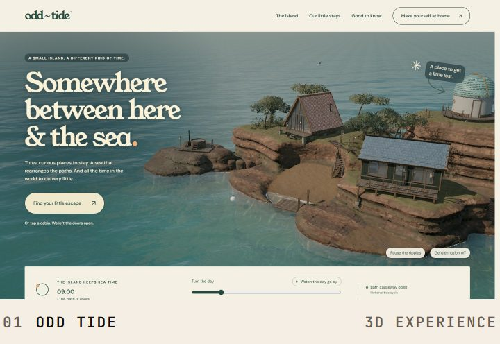</picture></a>
<a href="https://07-please-hold.williamking.workers.dev"><picture><source media="(prefers-color-scheme: dark)" srcset="assets/work/07-please-hold-dark.jpg">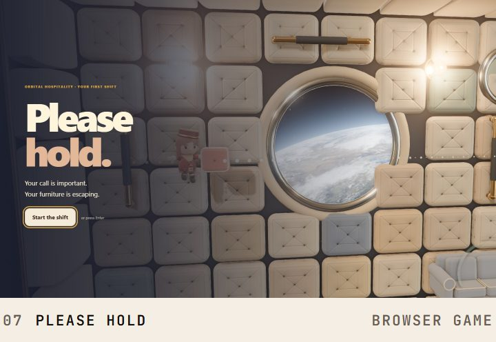</picture></a>
<a href="https://08-leaf-it-to-me.williamking.workers.dev"><picture><source media="(prefers-color-scheme: dark)" srcset="assets/work/08-leaf-it-to-me-dark.jpg">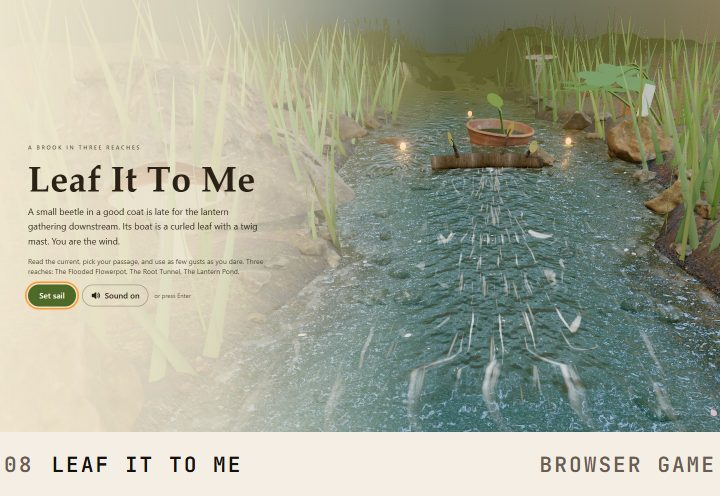</picture></a>
<a href="https://10-the-moon-has-a-gardener.williamking.workers.dev"><picture><source media="(prefers-color-scheme: dark)" srcset="assets/work/10-the-moon-has-a-gardener-dark.jpg">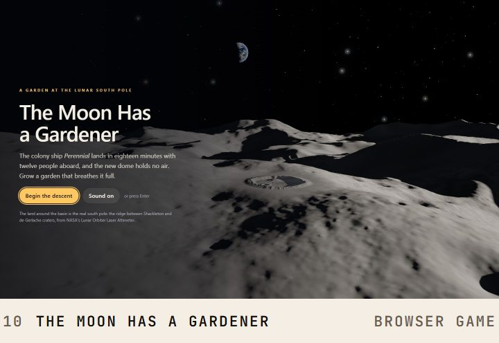</picture></a>
<a href="https://11-unscheduled-maintenance.williamking.workers.dev"><picture><source media="(prefers-color-scheme: dark)" srcset="assets/work/11-unscheduled-maintenance-dark.jpg">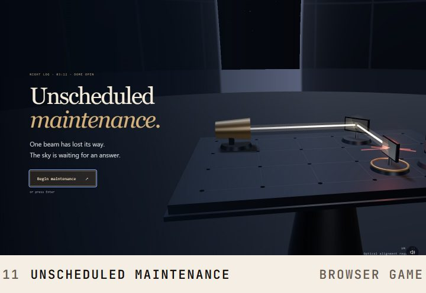</picture></a>
<a href="https://13-campfire-confidential.williamking.workers.dev"><picture><source media="(prefers-color-scheme: dark)" srcset="assets/work/13-campfire-confidential-dark.jpg">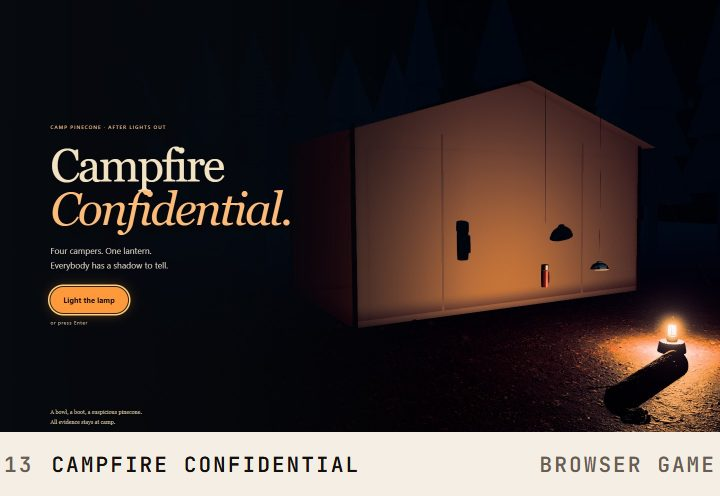</picture></a>
<a href="https://15-stillform.williamking.workers.dev"><picture><source media="(prefers-color-scheme: dark)" srcset="assets/work/15-stillform-dark.jpg">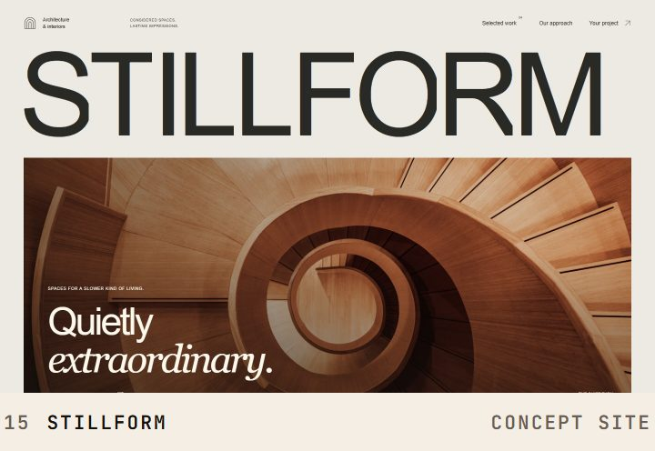</picture></a>
<a href="https://18-aurel.williamking.workers.dev"><picture><source media="(prefers-color-scheme: dark)" srcset="assets/work/18-aurel-dark.jpg">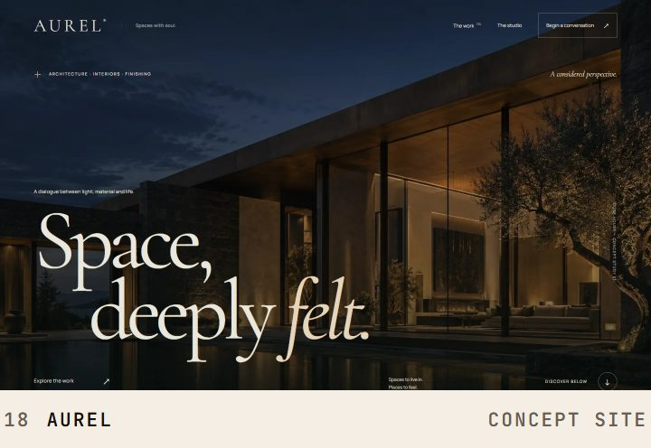</picture></a>
<a href="https://19-strata.williamking.workers.dev"><picture><source media="(prefers-color-scheme: dark)" srcset="assets/work/19-strata-dark.jpg">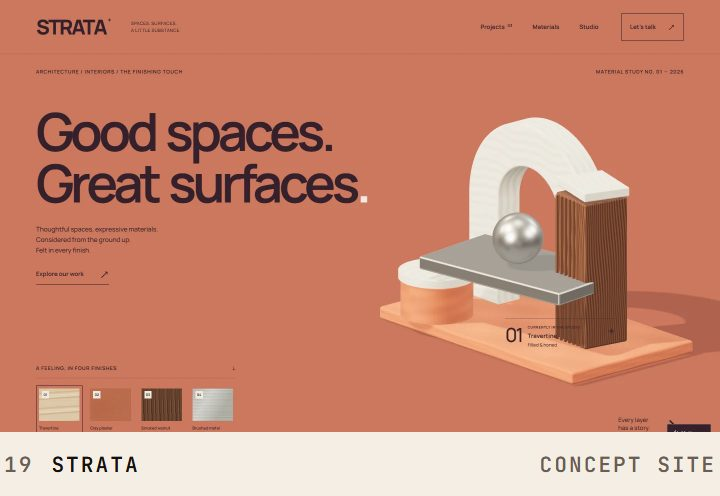</picture></a>

<!-- works:end -->

Nine of twenty public pieces. Each one is live; select a tile to open it.

<picture>
  <source media="(max-width: 600px) and (prefers-color-scheme: dark)" srcset="assets/robot-dark-narrow.svg">
  <source media="(max-width: 600px)" srcset="assets/robot-light-narrow.svg">
  <source media="(prefers-color-scheme: dark)" srcset="assets/robot-dark.svg">
  
</picture>

<picture>
  <source media="(prefers-color-scheme: dark)" srcset="assets/vision-dark.svg">
  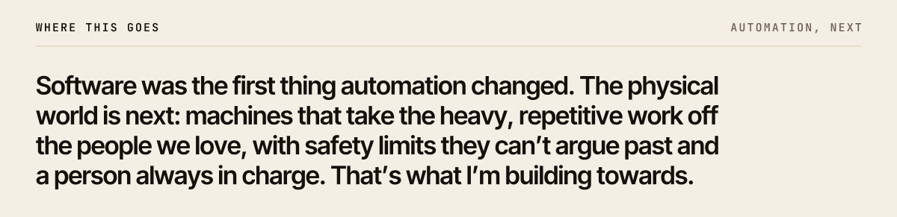
</picture>

<picture>
  <source media="(max-width: 600px) and (prefers-color-scheme: dark)" srcset="assets/robot-stack-dark-narrow.svg">
  <source media="(max-width: 600px)" srcset="assets/robot-stack-light-narrow.svg">
  <source media="(prefers-color-scheme: dark)" srcset="assets/robot-stack-dark.svg">
  
</picture>

<picture>
  <source media="(prefers-color-scheme: dark)" srcset="assets/workshop-dark.svg">
  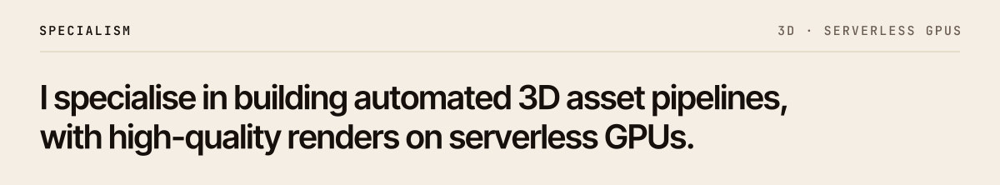
</picture>

<a href="https://x.com/boazbaraktcs/status/2103844689858453937">
  <picture>
    <source media="(prefers-color-scheme: dark)" srcset="assets/quote-dark.svg">
    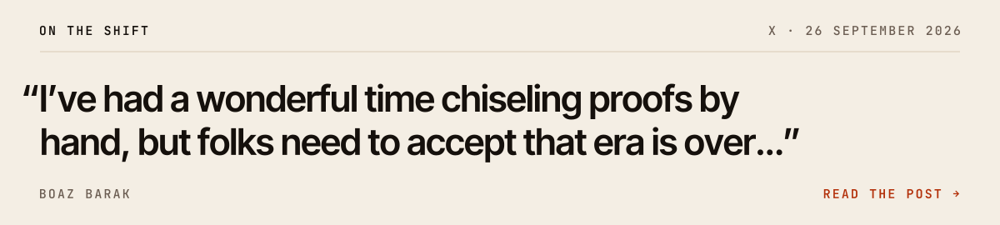
  </picture>
</a>

Boaz Barak on X, 26 September 2026 · [Read the post](https://x.com/boazbaraktcs/status/2103844689858453937) · [The keynote he was responding to](https://www.youtube.com/watch?v=vDjW_dRyKXY)

<picture>
  <source media="(max-width: 600px) and (prefers-color-scheme: dark)" srcset="assets/toolbox-dark-narrow.svg">
  <source media="(max-width: 600px)" srcset="assets/toolbox-light-narrow.svg">
  <source media="(prefers-color-scheme: dark)" srcset="assets/toolbox-dark.svg">
  
</picture>

<a href="https://linkedin.com/in/william-henry-king">
  <picture>
    <source media="(prefers-color-scheme: dark)" srcset="assets/btn-linkedin-dark.svg">
    
  </picture>
</a>

CV on request.
